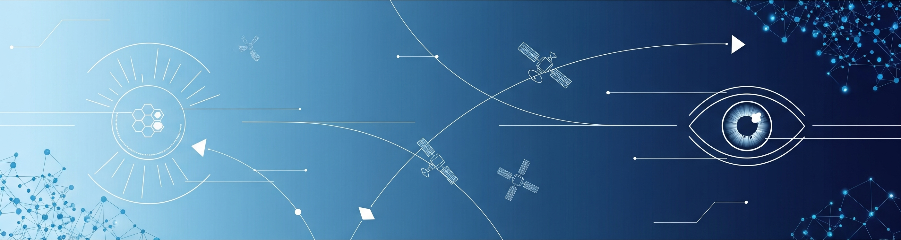

# Gabriel Oliveira

### Machine Learning Engineer | M.Sc. in AI @ ITA

> "I Would Spend 55 Minutes Defining the Problem and then Five Minutes Solving It" - Albert Einstein

I am a Machine Learning Engineer and former Air Force fighter pilot, leveraging a unique background in mission-critical operations to build robust and impactful AI solutions. My experience leading teams and solving complex challenges in the military has honed my problem-solving skills and attention to detail.

Currently, I am pursuing a **Master's degree in AI/Deep Learning at the Aeronautics Institute of Technology (ITA)**, one of Brazil's most prestigious engineering institutions. My research is focused on applying Computer Vision to satellite imagery for the detection of illegal mining, combining my passion for technology and mission-driven problem-solving.

---

### 💻 Tech Stack

### 📫 Get in Touch

### 🚀 Key Projects

<strong>🛰️ AI for Illegal Mining Detection (Master's Thesis Project)</strong>
- **Status:** In Progress

<strong>📊 From Data to Decision: Airbnb Analysis</strong>
- **[Read the Full Analysis](https://tinyurl.com/ekrwst22)**

<strong>🕸️ Web Scraping for Business Competitive Advantage</strong>
- **[Read the Full Article](https://tinyurl.com/26k5j95m)**

### 🧠 Complementary Learning

Here I share complementary learning resources and personal solutions I developed while deepening my understanding of AI and Deep Learning.

#### 📘 MIT 6.S191 – Introduction to Deep Learning (MIT)
- 🧪 **Fork:** [Official Lab Materials]([https://github.com/SEU_USUARIO/mit-6s191-fork](https://github.com/GabrielSOliveir/MIT-6.S191---introtodeeplearning))  
> This course by MIT covers the foundations of deep learning through three hands-on labs. Below are my implementations for each part, adapted and expanded with personal notes and experiments.

| Lab | Topic | Official Material | My Solutions |
|-----|-------|--------------------|--------------|
| 1 | Introduction to Deep Learning | [Lab 1 - Part 1 ](https://github.com/SEU_USUARIO/mit-6s191-fork/tree/master/lab1) | [Part 2](https://colab.research.google.com/drive/LINK_PART1_LAB1) |
| 2 | Deep Sequence Modeling (RNNs & LSTMs) | [Lab 2 - Part 1](https://github.com/SEU_USUARIO/mit-6s191-fork/tree/master/lab2) | [Part 2](https://colab.research.google.com/drive/LINK_PART1_LAB2)|
| 3 | Reinforcement Learning | [Lab 3 - Part 1](https://github.com/SEU_USUARIO/mit-6s191-fork/tree/master/lab3) | [Part 2](https://colab.research.google.com/drive/LINK_PART1_LAB3)
